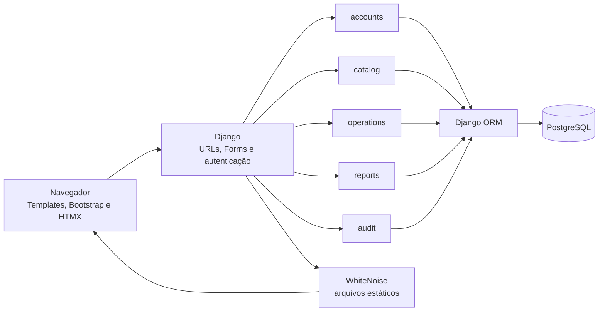

<h1 align="center">Olokuti Digital</h1>

<p align="center">
  MVP acadêmico e experimental para explorar fluxos de catálogo, tarefas e organização operacional.
</p>

<p align="center">
  <a href="https://olokuti-web-production.up.railway.app/"></a>
  <a href="https://github.com/RMBarros-Dev/Olokuti-Digital/actions/workflows/ci.yml"></a>
  <a href="https://github.com/RMBarros-Dev/Olokuti-Digital/actions/workflows/keepalive.yml"></a>
  
  
  
  <a href="LICENSE"></a>
</p>

> **Status: MVP acadêmico e experimental.** Este projeto não é um sistema oficial da Olokuti, não tem afiliação ou aprovação institucional declarada e não se conecta a sistemas da empresa. Necessidades, processos e valor operacional são hipóteses **a validar mediante investigação de campo**.

## Índice

- [Contexto e objetivo](#contexto-e-objetivo)
- [Escopo funcional](#escopo-funcional)
- [Arquitetura](#arquitetura)
- [Tecnologias](#tecnologias)
- [Começar localmente](#começar-localmente)
- [Configuração](#configuração)
- [Contas, grupos e permissões](#contas-grupos-e-permissões)
- [Testes e integração contínua](#testes-e-integração-contínua)
- [Idiomas e traduções](#idiomas-e-traduções)
- [Deploy e operação](#deploy-e-operação)
- [Segurança, dados e limitações](#segurança-dados-e-limitações)
- [Estrutura do repositório](#estrutura-do-repositório)
- [Contribuição e licença](#contribuição-e-licença)

## Contexto e objetivo

O projeto foi concebido no contexto da investigação **“Da identidade à inovação: memória, diagnóstico operacional e transformação digital do comércio sustentável em Barcelona — estudo de caso da Olokuti”**. A aplicação oferece um ambiente de prototipagem para avaliar conceitos de catálogo, tarefas e relatórios; ela não pressupõe que a empresa precise dessas funcionalidades.

O princípio de trabalho é separar fatos observados de hipóteses. Integrações, dados, requisitos, processos e identidade institucional só devem ser incorporados após evidência, autorização e validação adequadas.

## Escopo funcional

| Área | O que o MVP oferece |
| --- | --- |
| Acesso | Login, logout, sessões e fluxo de redefinição de senha do Django. |
| Dashboard | Resumo de produtos, tarefas e atividade recente, condicionado às permissões do usuário. |
| Catálogo | Produtos, categorias, pesquisa, filtros, origem, informações de sustentabilidade e exportação CSV. |
| Traduções de produtos | Registros localizados separados do texto original, sem substituir os dados-fonte. |
| Operações | Tarefas com produto opcional, responsável, prioridade, prazo e estados; filtros e atualização rápida de status com HTMX. |
| Relatórios | Resumo de tarefas por período e status, com exportação CSV protegida contra fórmulas de planilha. |
| Auditoria | Eventos mínimos de criação, atualização, mudança de status, exclusão e configuração. |
| Administração | Listagem, pesquisa, criação e edição de contas por usuários `is_staff`; grupos com permissões do Django. |
| Idiomas | Prefixos de URL e seletor para dez idiomas; os catálogos de interface são parciais. |
| Saúde da aplicação | `GET /health` retorna `200 OK`; `GET /health?db=1` valida também a conexão SQL ativa com o PostgreSQL. |

### Fora do escopo

Este MVP não implementa pagamentos, vendas, faturamento, gestão financeira, sincronização de inventário, integração omnicanal ou conexão com sistemas da Olokuti. Não é uma API pública nem um sistema pronto para uso operacional.

O comando `seed_demo` é opcional, só executa com `DEBUG=True` e cria registros sintéticos identificados como demonstração. Origens, certificações, fornecedores e afirmações de sustentabilidade desses registros não são verificadas.

## Arquitetura

Aplicação monolítica modular: o navegador acessa rotas Django; os módulos usam o ORM e a mesma base PostgreSQL; templates renderizam a interface e HTMX atualiza partes das listas. WhiteNoise publica os arquivos estáticos recolhidos no build.



Os módulos têm responsabilidades delimitadas:

| Módulo | Responsabilidade |
| --- | --- |
| `apps/accounts` | Dashboard, autenticação, grupos, permissões e administração de usuários. |
| `apps/catalog` | Categorias, produtos, traduções localizadas e CSV do catálogo. |
| `apps/operations` | Tarefas, filtros, mudanças de status e eventos operacionais. |
| `apps/reports` | Agregações e exportação de relatórios de tarefas. |
| `apps/audit` | Modelo, serviço e visualização dos eventos de auditoria. |
| `config/settings` | Configurações compartilhadas, local, de testes e produção. |

## Tecnologias

| Camada | Tecnologia |
| --- | --- |
| Linguagem e runtime | Python 3.12 |
| Backend | Django 5.2, Django ORM, Forms, Templates e autenticação nativa |
| Banco local e produção | PostgreSQL 14 ou superior; SQLite em memória nos testes |
| Interface | HTML, CSS, Bootstrap 5.3.9, HTMX 2.0.11 e JavaScript nativo |
| Arquivos estáticos | WhiteNoise |
| Servidor WSGI | Gunicorn |
| Qualidade | pytest, pytest-django e Ruff |
| Deploy configurado | Railpack/Railway; consulte a seção [Deploy e operação](#deploy-e-operação) sobre o formato atual de configuração |

Django 5.2 requer PostgreSQL 14 ou superior ([notas oficiais da versão 5.2](https://docs.djangoproject.com/en/5.2/releases/5.2/)). Docker, Node.js, Redis e microserviços não são requisitos para desenvolvimento local.

## Começar localmente

### Pré-requisitos

- Python 3.12 e `pip`;
- PostgreSQL 14 ou superior, com uma base vazia para o projeto;
- Git;
- GNU gettext apenas se você for extrair ou recompilar traduções;
- acesso à internet para os arquivos Bootstrap e HTMX carregados pelos CDNs do layout.

### 1. Criar a base local

No `psql`, com uma conta administrativa do PostgreSQL:

```sql
CREATE ROLE olokuti WITH LOGIN PASSWORD 'defina-uma-senha-local';
CREATE DATABASE olokuti_digital OWNER olokuti;
```

### 2. Criar o ambiente Python

No PowerShell, a partir da raiz do repositório:

```powershell
py -3.12 -m venv .venv
Copy-Item .env.example .env
.\.venv\Scripts\Activate.ps1
python -m pip install -r requirements/development.txt
```

Se a ativação do ambiente virtual estiver bloqueada pela política local do PowerShell, use diretamente `.\.venv\Scripts\python.exe` no lugar de `python` nos comandos seguintes.

### 3. Configurar e iniciar

Edite `.env` e substitua os valores de exemplo. Use uma senha URL-encoded na `DATABASE_URL` se ela contiver caracteres especiais. O `.env` é ignorado pelo Git; não o adicione ao repositório.

```powershell
python manage.py migrate
python manage.py createsuperuser
python manage.py runserver
```

Acesse [http://127.0.0.1:8000/](http://127.0.0.1:8000/). A raiz redireciona para o prefixo do idioma ativo; com a configuração padrão, o login fica em [`/en/accounts/login/`](http://127.0.0.1:8000/en/accounts/login/). O e-mail de redefinição de senha é enviado ao console no ambiente local.

Para criar dados sintéticos para uma demonstração local, execute `python manage.py seed_demo` com `DEBUG=True`. O comando avisa que os registros são fictícios e recusa execução fora do modo de depuração.

## Configuração

As configurações locais são carregadas de `.env` pelo `python-dotenv`. Em produção, defina-as como variáveis protegidas no provedor; não publique segredos no GitHub.

| Variável | Uso |
| --- | --- |
| `DJANGO_SETTINGS_MODULE` | `config.settings.local` localmente; `config.settings.production` em produção. |
| `DJANGO_SECRET_KEY` | Chave secreta longa e exclusiva por ambiente. O valor de exemplo não deve ser usado em produção. |
| `DATABASE_URL` | URL PostgreSQL local ou de produção. SQLite é aceito para testes; a configuração de produção exige PostgreSQL. |
| `DJANGO_ALLOWED_HOSTS` | Lista de hosts permitidos separada por vírgula. Produção recusa `*`. |
| `DJANGO_CSRF_TRUSTED_ORIGINS` | Origens confiáveis completas, incluindo `https://`, separadas por vírgula. Obrigatória em produção. |
| `DJANGO_EMAIL_BACKEND` | Backend de e-mail. O modo local usa o console; produção usa SMTP por padrão. |
| `EMAIL_HOST`, `EMAIL_PORT`, `EMAIL_HOST_USER`, `EMAIL_HOST_PASSWORD`, `EMAIL_USE_TLS` | Configuração do provedor SMTP autorizado. `EMAIL_HOST` é obrigatório quando o backend de produção é SMTP. |
| `DEFAULT_FROM_EMAIL` | Endereço remetente usado nas mensagens. |
| `DJANGO_TRUST_PROXY_SSL_HEADER` | Ative como `true` somente atrás de um proxy confiável que filtre e defina `X-Forwarded-Proto`. |
| `DJANGO_HSTS_SECONDS` | Duração do HSTS em segundos; o padrão de produção é um ano. |

`config.settings.production` mantém `DEBUG=False`, exige chave, PostgreSQL, hosts explícitos e origens CSRF confiáveis. HTTPS, cookies seguros e HSTS são configurados nessa camada.

## Contas, grupos e permissões

O superusuário criado com `createsuperuser` acessa o Django Admin. Usuários `is_staff` podem gerenciar contas pela interface em `/en/accounts/users/`. Na própria página, a ação de configurar grupos cria os grupos padrão e acrescenta as permissões-base sem remover permissões personalizadas existentes.

| Grupo padrão | Permissões incluídas |
| --- | --- |
| `Catalogue Team` | Visualizar, criar, editar e excluir produtos e categorias. |
| `Operations Team` | Visualizar produtos e visualizar, criar, editar e excluir tarefas. |
| `Auditors & Managers` | Visualizar e administrar produtos e tarefas, além de visualizar eventos de auditoria. **Esse grupo não é somente leitura.** |

Permissões usadas pelas áreas:

- Produtos: `catalog.view_product`, `catalog.add_product`, `catalog.change_product`, `catalog.delete_product`.
- Categorias: `catalog.view_category`, `catalog.add_category`, `catalog.change_category`, `catalog.delete_category`.
- Tarefas: `operations.view_operationaltask`, `operations.add_operationaltask`, `operations.change_operationaltask`, `operations.delete_operationaltask`.
- Auditoria: `audit.view_auditlog`.
- Relatórios: requerem visualização de produtos **e** tarefas.
- Gestão de usuários: requer `is_staff`.

A exclusão de categorias é bloqueada enquanto houver produtos relacionados. O dashboard oculta métricas sem permissão correspondente.

## Testes e integração contínua

Execute os mesmos verificadores usados no workflow do GitHub:

```powershell
python -m ruff check .
python -m pytest -q
```

O workflow [`.github/workflows/ci.yml`](.github/workflows/ci.yml) roda Ruff e pytest em Python 3.12 para pushes em `main` e pull requests. O Dependabot verifica semanalmente dependências Python e GitHub Actions.

Os testes usam `config.settings.test` e SQLite em memória. Eles cobrem autenticação, permissões, catálogo, traduções de produtos, tarefas, relatórios, auditoria, contas e segurança da exportação CSV. A suíte não valida conectividade com o PostgreSQL do provedor nem substitui uma verificação do ambiente de produção.

## Idiomas e traduções

Os prefixos configurados são `es-419`, `es-es`, `ca`, `gl`, `eu`, `en-us`, `en-gb`, `en`, `pt-br` e `pt-pt`. Os catálogos contêm traduções parciais e ainda precisam de revisão linguística humana; a interface pode exibir texto em inglês quando não houver tradução.

Os arquivos `.po` são a fonte editável e os `.mo` compilados estão versionados. O comando `python manage.py compile_locales` delega ao `compilemessages` do Django e não reescreve os `.po`. Para extrair novas strings e compilar, instale GNU gettext e execute:

```powershell
python manage.py makemessages -a
# Revise os arquivos locale/<idioma>/LC_MESSAGES/django.po.
python manage.py compile_locales
```

`ProductTranslation` mantém nome, descrição e informação de sustentabilidade separados do produto original. A aplicação só seleciona uma tradução da mesma variante regional; por exemplo, `pt-BR` não usa automaticamente uma tradução `pt-PT`.

## Deploy e operação

### Railway

O repositório contém `railway.json` com comandos para coleta de arquivos estáticos, migrações pré-deploy, Gunicorn, healthcheck `/health` e política de reinício. O arquivo não cria um projeto Railway, banco de dados, domínio ou variáveis e não comprova que exista um deployment ativo.

**Atenção ao formato:** em **12 de novembro de 2026**, Railway marca Config as Code (`railway.json`/`railway.toml`) como obsoleto. Arquivos existentes continuam válidos apenas para serviços que já os utilizam, com corte previsto para **1º de dezembro de 2026**; novos serviços não podem optar por esse formato. Consulte a [documentação Railway](https://docs.railway.com/config-as-code) e a [migração para Infrastructure as Code](https://docs.railway.com/infrastructure-as-code) antes de criar ou atualizar o serviço.

Para um serviço existente que ainda usa esse arquivo, o Railpack detecta `requirements.txt`; o comando de build recolhe estáticos, o comando pré-deploy executa `migrate` e o servidor inicia com Gunicorn na porta `$PORT`. Para um serviço novo, configure os comandos nas definições do Railway ou migre a configuração para o mecanismo IaC atual.

Variáveis de produção necessárias no serviço:

1. `DJANGO_SETTINGS_MODULE=config.settings.production`
2. `DJANGO_SECRET_KEY`: segredo forte, exclusivo de produção.
3. `DATABASE_URL`: PostgreSQL de produção previamente criado e autorizado.
4. `DJANGO_ALLOWED_HOSTS`: domínio Railway atribuído, sem protocolo e sem `*`.
5. `DJANGO_CSRF_TRUSTED_ORIGINS`: origem completa do domínio, por exemplo `https://seu-dominio.up.railway.app`.
6. `EMAIL_HOST`, `EMAIL_PORT`, `EMAIL_HOST_USER`, `EMAIL_HOST_PASSWORD`, `EMAIL_USE_TLS=true` e `DEFAULT_FROM_EMAIL` para SMTP.

Depois que o domínio for criado, inclua-o em `DJANGO_ALLOWED_HOSTS` e `DJANGO_CSRF_TRUSTED_ORIGINS` e faça novo deploy. `healthcheck.railway.app` já está permitido para o healthcheck. A configuração não provisiona banco nem migra dados entre provedores.

Para configurar os comandos manualmente no painel:

| Campo do serviço | Comando ou valor |
| --- | --- |
| Build | `python manage.py collectstatic --noinput` |
| Pre-deploy | `python manage.py migrate --noinput` |
| Start | `gunicorn config.wsgi:application --bind 0.0.0.0:$PORT --access-logfile - --error-logfile -` |
| Healthcheck path | `/health` |

### Render, Vercel e Keep-Alive 24/7 (Supabase)

Além do `railway.json`, o repositório inclui configurações prontas para hospedagem gratuita permanente conectada ao **Supabase PostgreSQL**:

- **`render.yaml` (Render Blueprint):** configura o serviço web Python gratuito (`gunicorn` + `collectstatic` + `migrate`) com healthcheck em `/health`.
- **`vercel.json` (Vercel Serverless WSGI):** expõe `config/wsgi.py` (`app = application`) para execução serverless sem hibernação de container.
- **`.github/workflows/keepalive.yml` (Monitoramento & Keep-Alive 24/7):** executa automaticamente a cada 6 horas um `GET /health?db=1` (que realiza `SELECT 1` no PostgreSQL), mantendo o serviço web aquecido e impedindo a pausa automática de 7 dias por inatividade no plano gratuito do Supabase. Para apontar para um novo domínio (como Render ou Vercel), basta definir a variável de repositório `APP_HEALTHCHECK_URL` em *Settings → Secrets and variables → Actions → Variables*.

### Arquivos estáticos, logs e backups

WhiteNoise serve os arquivos recolhidos em `STATIC_ROOT`; o build de produção precisa executar `collectstatic`. Os logs são enviados a stdout/stderr em formato JSON. Não inclua dados pessoais ou conteúdo de tarefas em mensagens de log.

Para PostgreSQL, defina backups periódicos em destino protegido e criptografado, com credencial de menor privilégio. Retenha cópias de acordo com a política aplicável e teste uma restauração antes de depender do backup. Não coloque senhas em comandos, histórico do terminal, documentação ou arquivos versionados.

## Segurança, dados e limitações

- Não use dados pessoais ou operacionais reais sem autorização e salvaguardas apropriadas.
- Não trate exemplos, hipóteses, origens ou certificações como fatos sobre a Olokuti.
- Não há integração com sistemas da empresa nem validação institucional do produto.
- Os eventos de auditoria ficam na mesma base da aplicação; não são um registro inviolável nem guardam snapshots completos das alterações.
- Bootstrap e HTMX são carregados de CDNs. Ambientes restritos precisam disponibilizar esses arquivos localmente.
- Traduções de interface são parciais e não passaram por revisão humana completa.
- Os testes não validam uma conexão real de produção com PostgreSQL.
- `railway.json` está em formato legado e requer migração ou configuração atualizada do serviço para deployments novos/após o período de compatibilidade.

Consulte [`CONTRIBUTING.md`](CONTRIBUTING.md) para as regras de contribuição e tratamento de dados de demonstração. Não publique credenciais ou detalhes exploráveis em issues públicas.

## Estrutura do repositório

```text
.
├── apps/
│   ├── accounts/       # autenticação, grupos e usuários
│   ├── audit/          # eventos de auditoria
│   ├── catalog/        # produtos, categorias e traduções
│   ├── operations/     # tarefas e status
│   └── reports/        # resumos e CSV
├── config/
│   └── settings/       # base, local, test e production
├── locale/             # catálogos gettext .po/.mo
├── static/             # CSS e JavaScript
├── templates/          # templates Django
├── tests/              # testes automatizados
├── requirements/       # dependências de produção e desenvolvimento
├── .github/workflows/  # CI
├── .env.example
├── manage.py
├── Procfile
├── railway.json        # configuração Railway legada
└── pyproject.toml      # configuração do pytest e Ruff
```

## Contribuição e licença

Leia [`CONTRIBUTING.md`](CONTRIBUTING.md) antes de enviar alterações. Toda contribuição deve manter explícita a natureza experimental do MVP e evitar dados ou afirmações não verificadas.

O código original e a documentação deste repositório estão sob a [licença MIT](LICENSE). Ela não concede direitos sobre marcas, nomes, logotipos, dados ou materiais de terceiros. O nome “Olokuti” identifica o contexto acadêmico e não implica afiliação ou aprovação institucional.
