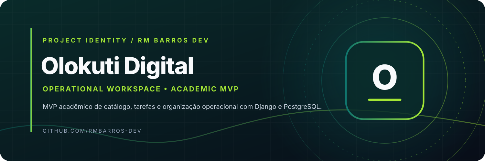
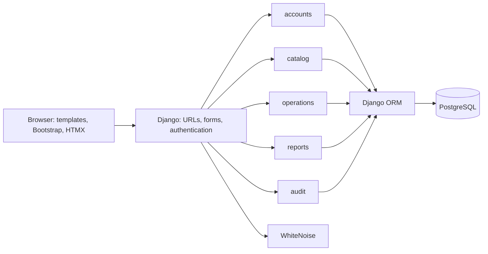
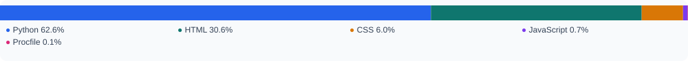

<p align="right"><strong>Language:</strong> <a href="README.pt-BR.md">Português (Brasil)</a> · <a href="README.md">English</a></p>

<p align="center"></p>
<p align="center"></p>

<h1 align="center">Olokuti Digital</h1>
<p align="center"><strong>Academic and experimental MVP for product catalogue and operational workflows.</strong><br>Organized information. Connected operations.</p>
<p align="center">
  
  
  <a href="https://olokuti-web-production.up.railway.app/"></a>
  <a href="https://github.com/RMBarros-Dev/Olokuti-Digital/actions/workflows/ci.yml"></a>
  <a href="https://github.com/RMBarros-Dev/Olokuti-Digital/actions/workflows/keepalive.yml"></a>
  
</p>

> **Project status:** academic and experimental MVP. This repository is not an official Olokuti system, has no declared institutional affiliation or approval, and does not connect to company systems. Operational needs and value hypotheses require field validation.

## Contents

- [01 · Overview](#01--overview)
- [02 · Context and Purpose](#02--context-and-purpose)
- [03 · Scope](#03--scope)
- [04 · Functional Areas](#04--functional-areas)
- [05 · Architecture](#05--architecture)
- [06 · Technology Stack](#06--technology-stack)
- [07 · Requirements](#07--requirements)
- [08 · Local Installation](#08--local-installation)
- [09 · Environment Configuration](#09--environment-configuration)
- [10 · Run the Application](#10--run-the-application)
- [11 · Accounts, Groups and Permissions](#11--accounts-groups-and-permissions)
- [12 · Tests and Continuous Integration](#12--tests-and-continuous-integration)
- [13 · Languages and Localization](#13--languages-and-localization)
- [14 · Deployment and Operations](#14--deployment-and-operations)
- [15 · Security, Data and Known Limitations](#15--security-data-and-known-limitations)
- [16 · Repository Structure](#16--repository-structure)
- [17 · Documentation and Contribution](#17--documentation-and-contribution)
- [18 · License and Attribution](#18--license-and-attribution)

## 01 · Overview

Olokuti Digital is a Django application prototype for exploring product catalogue information, operational tasks, reports and audit events. It is intended for learning and validation, not as a production-ready business system.

Configured demonstration URL: [Railway environment](https://olokuti-web-production.up.railway.app/). Availability and deployed state may change.

## 02 · Context and Purpose

The project originated in an academic study about sustainable commerce and digital transformation in Barcelona. It provides a prototyping environment to explore catalogue and task-management concepts without assuming that the referenced company needs or has adopted these features.

Facts, hypotheses and proposed workflows must remain distinguishable. Company data, integrations, processes and institutional identity require evidence, authorization and validation before use.

## 03 · Scope

The MVP explores authentication, catalogue management, product translations, operational tasks, reports, audit events, user administration and multilingual navigation.

It does not implement payments, sales, invoicing, financial management, inventory synchronization, omnichannel integration or connection to Olokuti systems.

## 04 · Functional Areas

| Area | Documented behavior |
|---|---|
| Accounts | Login, public registration, logout, sessions and Django password-reset flow. |
| Dashboard | Product, task and recent-activity summaries, filtered by permissions. |
| Catalogue | Products, categories, search, filters, origin, sustainability fields and CSV export. |
| Product translations | Localized records kept separate from original source text. |
| Operations | Tasks with optional product, assignee, priority, due date, status and HTMX status updates. |
| Reports | Task summaries by period/status and CSV export with spreadsheet-formula protection. |
| Audit | Minimal events for creation, updates, status changes, deletion and configuration. |
| Administration | Staff-only user listing, search, creation and editing. |
| Health | `GET /health`; `GET /health?db=1` also checks the active PostgreSQL connection. |

The optional `seed_demo` command creates synthetic records only when `DEBUG=True`; those records are not verified supplier, origin or sustainability claims.

## 05 · Architecture

The application is a modular Django monolith. The browser uses Django routes and templates; modules share the Django ORM and PostgreSQL database. HTMX updates selected interface fragments, and WhiteNoise serves collected static files.



| Module | Responsibility |
|---|---|
| `apps/accounts` | Dashboard, authentication, groups, permissions and user administration. |
| `apps/catalog` | Categories, products, localized product text and catalogue CSV. |
| `apps/operations` | Tasks, filters, status changes and operational events. |
| `apps/reports` | Aggregations and task report exports. |
| `apps/audit` | Audit event model, service and views. |
| `config/settings` | Shared, local, test and production settings. |

## 06 · Technology Stack

| Layer | Technology |
|---|---|
| Runtime | Python 3.12 |
| Backend | Django 5.2, ORM, Forms, Templates and built-in authentication |
| Database | PostgreSQL 14+; in-memory SQLite for tests |
| Interface | HTML, CSS, Bootstrap 5.3.9, HTMX 2.0.11 and native JavaScript |
| Static files | WhiteNoise |
| WSGI server | Gunicorn |
| Quality | pytest, pytest-django and Ruff |

Django 5.2 requires PostgreSQL 14 or newer. Docker, Node.js, Redis and microservices are not required for local development.

## 07 · Requirements

- Python 3.12 and pip.
- PostgreSQL 14+ and an empty project database.
- Git.
- GNU gettext only when extracting or recompiling translations.
- Internet access for Bootstrap and HTMX assets loaded from CDNs.

## 08 · Local Installation

Create a database role and database using an administrative PostgreSQL account:

```sql
CREATE ROLE olokuti WITH LOGIN PASSWORD 'set-a-local-password';
CREATE DATABASE olokuti_digital OWNER olokuti;
```

Create and activate a Python environment (PowerShell):

```powershell
py -3.12 -m venv .venv
Copy-Item .env.example .env
.\.venv\Scripts\Activate.ps1
python -m pip install -r requirements/development.txt
```

## 09 · Environment Configuration

Edit `.env` locally and replace all example values. The file is ignored by Git. Never commit secrets.

| Variable | Purpose |
|---|---|
| `DJANGO_SETTINGS_MODULE` | `config.settings.local` locally; `config.settings.production` in production. |
| `DJANGO_SECRET_KEY` | Unique, strong secret for each environment. |
| `DATABASE_URL` | PostgreSQL connection URL. Production requires PostgreSQL. |
| `DJANGO_ALLOWED_HOSTS` | Comma-separated host allowlist; production rejects `*`. |
| `DJANGO_CSRF_TRUSTED_ORIGINS` | Full trusted origins, including scheme. |
| `DJANGO_EMAIL_BACKEND` | Local console backend or production SMTP backend. |
| `EMAIL_HOST`, `EMAIL_PORT`, `EMAIL_HOST_USER`, `EMAIL_HOST_PASSWORD`, `EMAIL_USE_TLS` | Authorized SMTP configuration. |
| `DEFAULT_FROM_EMAIL` | Sender address. |
| `DJANGO_TRUST_PROXY_SSL_HEADER` | Enable only behind a trusted proxy that sanitizes forwarded headers. |
| `DJANGO_HSTS_SECONDS` | HSTS duration; production defaults to one year. |

Production settings keep `DEBUG=False`, require explicit hosts, a secret key, PostgreSQL and trusted CSRF origins.

## 10 · Run the Application

```powershell
python manage.py migrate
python manage.py createsuperuser
python manage.py runserver
```

Open [http://127.0.0.1:8000/](http://127.0.0.1:8000/). The root redirects to the active language prefix. Local password-reset email is written to the console.

For synthetic local data, run `python manage.py seed_demo` with `DEBUG=True`.

## 11 · Accounts, Groups and Permissions

Public registration creates a basic account without automatically assigning operational groups or permissions. Role assignment is an explicit administrative action after account review. Administrative access requires an authorized `is_staff` user.

Default groups are configured through the staff-only administration flow:

| Group | Permissions |
|---|---|
| `Catalogue Team` | View, add, change and delete products and categories. |
| `Operations Team` | View products and view, add, change and delete operational tasks. |
| `Auditors & Managers` | Manage products and tasks and view audit events. This group is not read-only. |

Reports require permission to view both products and tasks. User administration requires `is_staff`. Category deletion is blocked while related products exist. Dashboard metrics are hidden when the corresponding permission is absent.

## 12 · Tests and Continuous Integration

Run the repository checks:

```powershell
python -m ruff check .
python manage.py check --settings=config.settings.test
python manage.py makemigrations --check --dry-run --settings=config.settings.test
python -m pytest -q
```

The GitHub Actions CI workflow runs Ruff, Django system checks, pending-migration detection and pytest on Python 3.12 for pushes to `main` and pull requests. Tests use the test settings and in-memory SQLite. They cover authentication, permissions, catalogue, translations, tasks, reports, audit events, accounts and CSV export protection.

These tests do not validate connectivity to the hosted PostgreSQL service or replace production-environment checks.

## 13 · Languages and Localization

Configured URL language prefixes: `es-419`, `es-es`, `ca`, `gl`, `eu`, `en-us`, `en-gb`, `en`, `pt-br` and `pt-pt`. Interface catalogues are partial and require human linguistic review; untranslated strings may appear in English.

Editable gettext `.po` files and compiled `.mo` files are versioned. To extract and compile messages, install GNU gettext:

```powershell
python manage.py makemessages -a
# Review locale/<language>/LC_MESSAGES/django.po.
python manage.py compile_locales
```

Product translations are stored separately from original product data. Regional variants are not silently substituted (for example, `pt-BR` does not automatically fall back to `pt-PT` product text).

## 14 · Deployment and Operations

The repository contains deployment descriptors for Railway, Render and Vercel. Their presence does not prove that all three providers are active or configured.

- `railway.json` defines Railpack, static collection, a pre-deploy migration command, Gunicorn, `/health` and restart behavior.
- `render.yaml` describes a Render Blueprint web service. Its build command installs production dependencies, collects static files and runs migrations; the start command uses Gunicorn.
- `vercel.json` defines a serverless WSGI entry point through `config/wsgi.py`. Serverless execution has provider-specific constraints and must be tested before being treated as a supported production target.
- `.github/workflows/keepalive.yml` sends `GET /health?db=1` every six hours. The endpoint checks PostgreSQL with `SELECT 1`; the URL can be changed through the `APP_HEALTHCHECK_URL` Actions variable. A successful request proves connectivity only at that moment, not continuous availability.

**Railway migration notice (November 2026):** Railway has deprecated Config as Code. Existing services using `railway.json` / `railway.toml` can continue using those files only until **December 1, 2026**; new services cannot opt into Config as Code. Railway recommends migrating to Infrastructure as Code (`.railway/railway.ts`). See the [official deprecation notice](https://docs.railway.com/config-as-code) and [migration guide](https://docs.railway.com/infrastructure-as-code). Do not delete or replace the current file until the active Railway service and its settings have been verified.

Production variables must be configured as protected provider variables. Set the actual assigned hostname in `DJANGO_ALLOWED_HOSTS` and the full HTTPS origin in `DJANGO_CSRF_TRUSTED_ORIGINS`. Provision PostgreSQL separately and validate migrations, backups and restore procedures.

## 15 · Security, Data and Known Limitations

- Never publish credentials, tokens, connection strings or personal data.
- Public registration does not grant operational permissions.
- The demo seed data is synthetic and must not be presented as verified business information.
- Logs are emitted to stdout/stderr; avoid logging personal data or task contents.
- PostgreSQL backups should be encrypted, access-controlled and restore-tested.
- The MVP is not an official company system, a public API or a production-ready operational platform.
- The previous removal of a demo credential from documentation does not prove that any deployed credential was rotated. Deployment-side credential rotation and activity review are separate operational tasks.

## 16 · Repository Structure

```text
apps/
  accounts/       # authentication, groups and users
  audit/          # audit events
  catalog/        # products, categories and translations
  operations/     # tasks and status
  reports/        # summaries and CSV
config/settings/  # base, local, test and production
locale/           # gettext .po/.mo catalogues
static/           # CSS and JavaScript
templates/        # Django templates
tests/            # automated tests
requirements/     # production and development dependencies
.github/workflows/
.env.example
manage.py
Procfile
railway.json
render.yaml
vercel.json
pyproject.toml
```

## 17 · Documentation and Contribution

- [Contribution guide](CONTRIBUTING.md).
- [Security policy](SECURITY.md).
- [Project structure](docs/project-structure.md).
- [Technology stack](docs/technology-stack.md).
- [Development methodology](docs/development-methodology.md).
- [Quality and testing](docs/quality/README.md).
- [Evolution roadmap](docs/roadmap.md).
- [Reference projects](docs/reference-projects.md).
- [Architecture](docs/architecture/README.md).
- [Brand guide](docs/brand/README.md).
- [Environment example](.env.example).
- [CI workflow](.github/workflows/ci.yml).

Contributions must preserve the experimental nature of the MVP and avoid unverified data or claims. Do not publish exploitable details or credentials in public issues.

## 18 · License and Attribution

The source code and original documentation are distributed under the [MIT License](LICENSE). The license does not grant rights to third-party trademarks, names, logos, data or materials. The name “Olokuti” identifies the academic study context and does not imply institutional affiliation or approval.


## Engineering Metrics

<div align="center">
  
  
  
  
  
</div>

<!-- REPOSITORY_METRICS_START -->
### Language distribution (GitHub Linguist)



| Language | Source bytes | Share |
|---|---:|---:|
| Python | 109,893 | 62.63% |
| HTML | 53,751 | 30.63% |
| CSS | 10,548 | 6.01% |
| JavaScript | 1,168 | 0.67% |
| Procfile | 97 | 0.06% |

_Total measured source bytes: 175,457. Refreshed: 2026-11-20 12:52 UTC._

<!-- REPOSITORY_METRICS_END -->

### Technical verification

| Dimension | Implemented evidence | Measurement boundary |
|---|---|---|
| Runtime / backend | Python 3.12, Django 5.2 | Academic and experimental MVP, not production software. |
| Architecture | Modular Django monolith: accounts, catalog, operations, reports and audit | Shared Django ORM and PostgreSQL persistence. |
| Database | PostgreSQL 14+; in-memory SQLite for tests | No claim of production-grade resilience or availability. |
| Interface | Django templates, Bootstrap 5.3.9, HTMX 2.0.11 and native JavaScript | Server-rendered application with targeted HTMX updates. |
| Quality | pytest, pytest-django and Ruff | Coverage percentage is not stated here. |
| CI | [CI workflow](.github/workflows/ci.yml) | Current result is shown by the workflow badge above. |
| Operational check | [Keepalive workflow](.github/workflows/keepalive.yml) and health endpoint | Availability checks do not prove application correctness or production readiness. |
| Security / data | Django authentication and permission groups are documented; secrets belong in environment configuration | MVP limitations and synthetic seed data must be respected; no external company system integration is claimed. |
