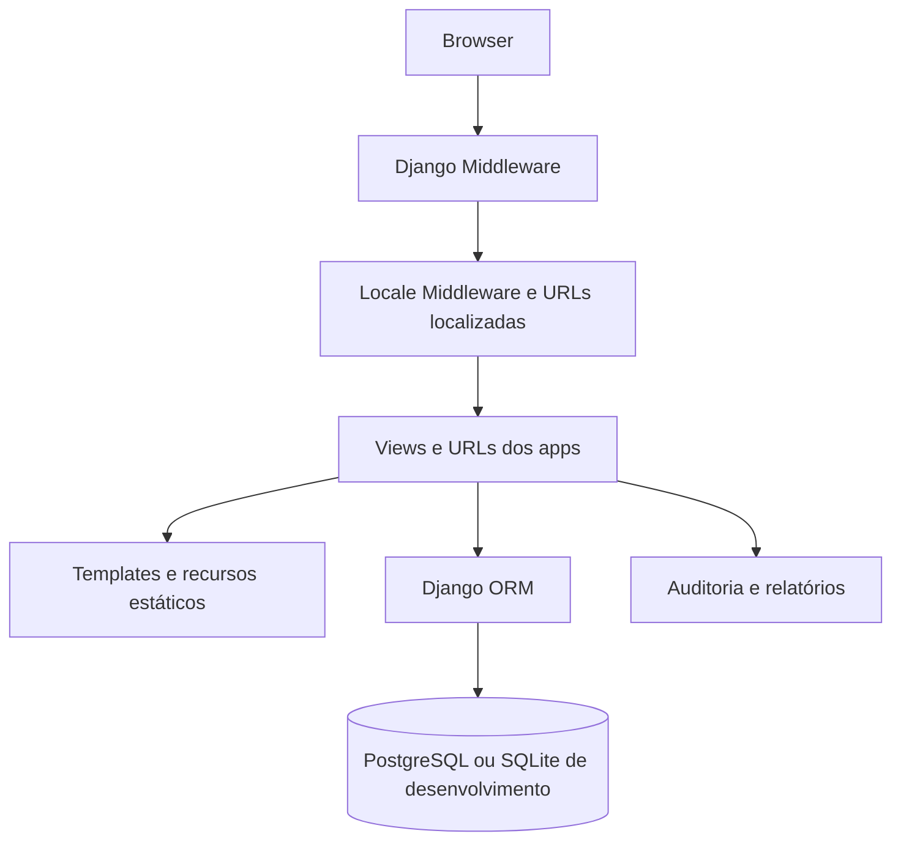

# Arquitetura do Olokuti Digital

## Visão geral

Desenvolvo o Olokuti Digital como MVP acadêmico e experimental em Django. Organizo o backend em aplicações por domínio, utilizo templates e recursos estáticos e mantenho o acesso ao banco configurado por `DATABASE_URL`.

## Componentes observados

| Componente | Responsabilidade |
|---|---|
| `config/` | Configurações Django, URLs, ASGI e WSGI |
| `apps/accounts/` | Contas, autenticação e permissões |
| `apps/catalog/` | Funcionalidades de catálogo |
| `apps/operations/` | Operações e listas de trabalho |
| `apps/reports/` | Relatórios |
| `apps/audit/` | Auditoria |
| `templates/` e `static/` | Interface e recursos estáticos |
| `locale/` | Catálogos de tradução do Django |
| `tests/` | Testes automatizados |

## Fluxo arquitetural

## Dados e configuração

Leio a conexão de banco a partir de `DATABASE_URL`. O parser em `config/settings/base.py` contempla PostgreSQL e SQLite. Para o pooler transacional do Supabase, desativo cursores server-side e mantenho conexões persistentes desabilitadas.

O endpoint `/health?db=1` executa `SELECT 1` para validar conectividade com o banco.

## Idiomas

Utilizo `LocaleMiddleware`, URLs localizadas e catálogos em `locale/`. Mantenho a lista de idiomas suportados e os procedimentos de compilação alinhados ao README e aos arquivos de tradução do repositório.

## Qualidade e segurança

O workflow executa Ruff e pytest. Mantenho testes para parsing de URLs de banco, autenticação, catálogo, operações, relatórios e permissões. Nos exemplos e contribuições, utilizo dados sintéticos e não versiono credenciais reais.

## Referências

- [README](../../README.md)
- [Contribuição](../../CONTRIBUTING.md)
- [Política de segurança](../../SECURITY.md)
- [Decisão arquitetural atual](../decisions/0001-current-architecture.md)
